# 1. Goal

Two goals for this project:

- **Build a small system** on the Tang Nano 4K: the FPGA does the fast work (camera pixels, CAN
  bits), the Cortex-M3 runs the firmware that controls it.
- **Learn LiteX** and let it do the plumbing (buses, registers, build scripts), so each step goes
  faster than writing everything by hand.

What came out of it: a CAN controller and an OV2640 camera, both living in a LiteX SoC. On request
the M3 reads a full 800 × 600 greyscale picture and sends it to a Linux board that saves it as a
PNG; over CAN, it answers a Linux test tool frame by frame.

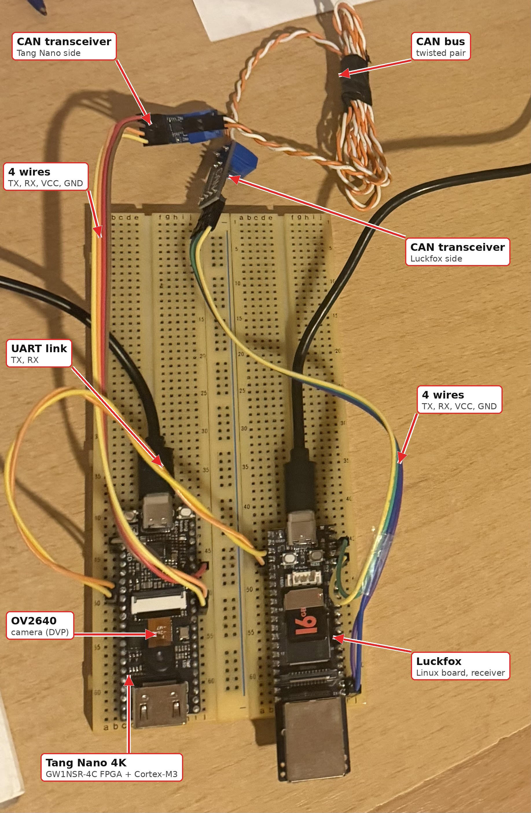


> [!note] What this post is (and isn't)
> This is a system-level write-up: the blocks, how they connect, and the decisions behind them.
> It deliberately shows no LiteX Python or Verilog; the full source lives in the repository
> [martiniio/can-tang-nano-litex](https://github.com/martiniio/can-tang-nano-litex) for anyone who
> wants the details.

# 2. The Big Picture

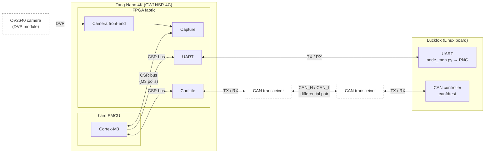

Solid boxes are what we build or program; dashed boxes are off-the-shelf parts (the camera module
and the two CAN transceivers). The rule behind the split: **anything that happens every pixel or
every bit stays in the FPGA**. The M3 only handles control and finished results, and it always
asks: every arrow into the M3 is a register it reads, not a signal that wakes it up (more on that
in 3.6).

# 3. LiteX

## 3.1 What it is

[LiteX](https://github.com/enjoy-digital/litex) is an open-source framework for building
systems-on-chip on FPGAs. You describe the hardware in Python, and LiteX generates the Verilog and
runs the vendor tools. It also comes with ready-made cores: CPUs, UART, timers, memories, bus
interconnect.

## 3.2 What it does for you

- Wires the **bus** between the CPU and every peripheral.
- Gives every peripheral its **address** automatically.
- Turns the **registers** you declare in Python into C headers (`csr.h`, `soc.h`) for the firmware.
- Runs the **build** (here Gowin) and provides startup code, `printf` and a linker script.

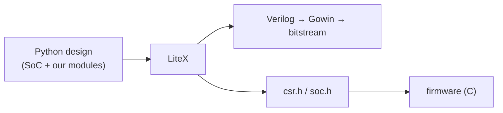

The nice part: a new hardware block is one Python class with a few registers, and the firmware can
use it immediately. Hardware and firmware never disagree about an address or a size.

## 3.3 The hard Cortex-M3

The M3 is a hard block on the chip (Gowin calls it the EMCU), not a CPU built from FPGA logic.
LiteX wraps it as the SoC's CPU. What sits where:

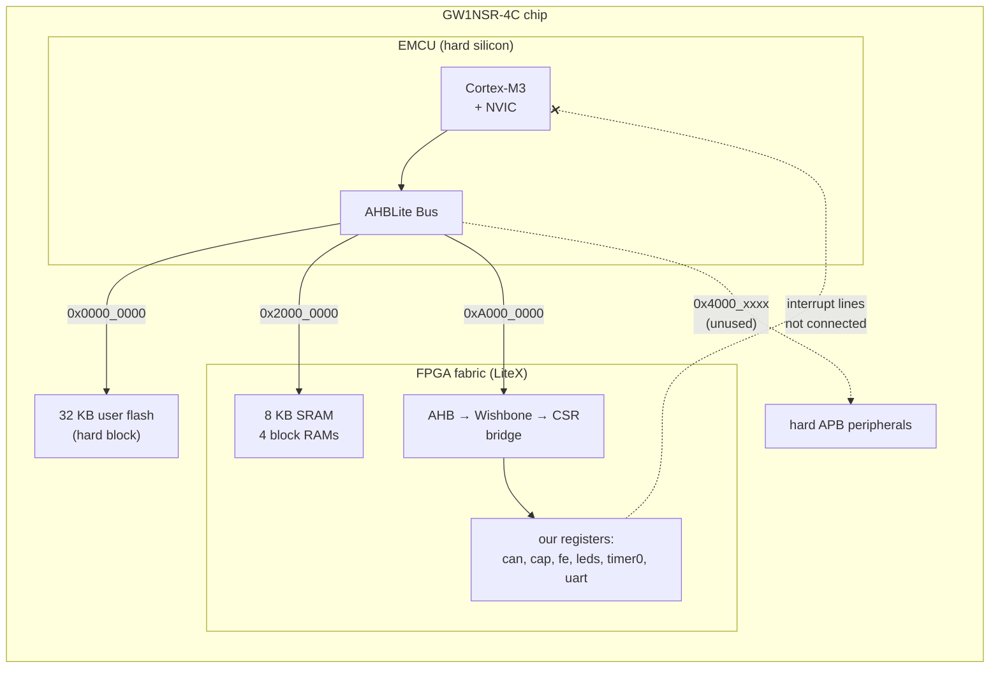

<figure style="margin: 0;">
  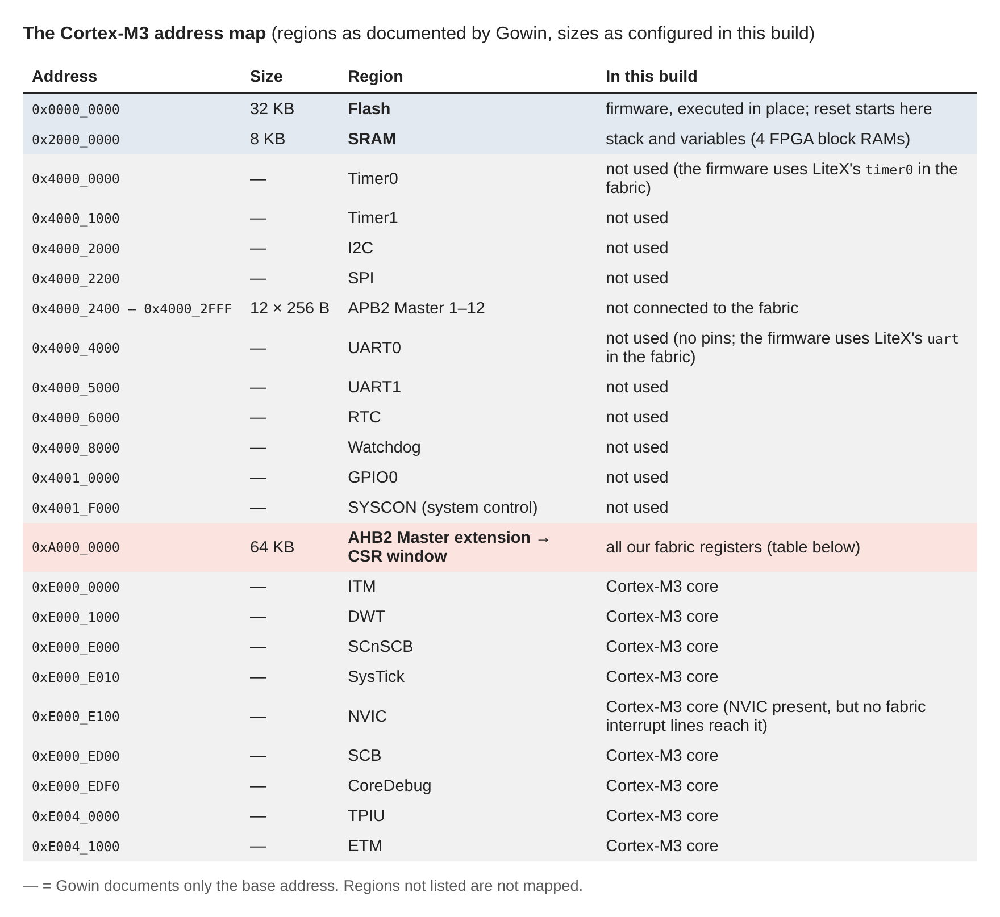
  <figcaption>The Cortex-M3 address map</figcaption>
</figure>


- The firmware runs from the chip's **32 KB flash**.
- Its **8 KB SRAM** is built from 4 of the FPGA's block RAMs.
- Everything we build in the FPGA is reached through **one 64 KB window at `0xA000_0000`**.
- The M3 has an interrupt controller (NVIC), but **no line from the fabric reaches it**, and there
  is no DMA: the firmware polls (see 3.6).

One Gowin quirk: the M3 didn't boot at first. LiteX leaves the flash data line unconnected (the
open-source tools wire it internally), but Gowin ties it to zero, so the M3 read only zeros. The
SoC script now connects it by hand.

## 3.4 The register map

Each peripheral gets a 2 KB bank inside the window (build with `--with-camera --with-can`):

| Bank | Address | What |
|---|---|---|
| `can` | `0xA000_0000` | CanLite |
| `cap` | `0xA000_0800` | Capture |
| `fe` | `0xA000_1000` | camera front-end |
| `leds` | `0xA000_1800` | LEDs |
| `timer0` | `0xA000_2000` | timer |
| `uart` | `0xA000_2800` | UART |

The firmware never uses these numbers directly; it calls the generated functions, e.g.
`cap_status_read()`. Leave out a block and the others simply move up.

## 3.5 Gowin-specific: from Python to a running board

LiteX describes the system, but turning it into a bitstream is the vendor's job. On this board that
means Gowin's tools, which here run on a Windows host, while LiteX and the firmware build live in an
Ubuntu VM.

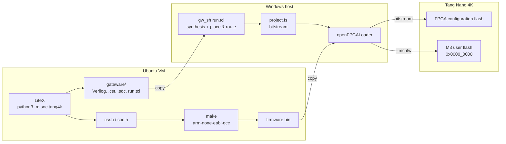

**1. Generate (VM).** LiteX writes the whole Gowin project without running it:

```bash
python3 -m soc.tang4k --cpu-type=gowin_emcu --with-camera --with-can --uart-baudrate 3000000 \
                      --build --no-compile-gateware
```

Out come the Verilog, the pin constraints (`.cst`), the timing constraints (`.sdc`), a `run.tcl`
script for Gowin, and the C headers for the firmware.

**2. Firmware (VM).** `make` compiles the firmware with `arm-none-eabi-gcc` against the generated
headers and LiteX's small libraries, and produces a raw `firmware.bin` for the M3. One SoC carries
both blocks; a compile flag picks the test program:

```bash
make clean && make            # camera test
make clean && make APP=can    # CAN test
```

**3. Bitstream (Windows).** The generated files are copied to the Windows host, where Gowin's
command-line tool `gw_sh` runs `run.tcl`: synthesis, then place & route, and finally the bitstream
`impl/pnr/project.fs`. A small `flash.sh` script wraps this: it turns on Gowin's verbose reports,
keeps the full log in a file and prints a short summary (errors, resource use, maximum clock
frequency), so a failed build is obvious at a glance.

**4. Program (Windows).** One `openFPGALoader` call writes both parts into the chip's flash:

```bash
openFPGALoader -b tangnano4k -f --mcufw firmware.bin impl/pnr/project.fs
```

- the bitstream (`project.fs`) goes into the FPGA's configuration flash, so the fabric loads it at
  every power-up;
- the firmware (`--mcufw`) goes into the M3's flash at `0x0000_0000`, where it starts executing
  after reset.

A change that only touches the firmware skips steps 1 and 3: `make`, then program again.

## 3.6 The catch: what this combination costs

LiteX on this board works, but a few things come with it:

> [!warning] No interrupts from the fabric
> The M3's NVIC has inputs meant for interrupts from the FPGA, but LiteX's EMCU integration ties
> them to zero. LiteX blocks can still declare interrupts (the CanLite wrapper has "frame received"
> and "bus error" events), but they never reach the CPU. **The firmware has to poll every block,
> and whatever it is doing, it must come back in time.**

What that means in practice:

- **CAN:** the receive FIFO holds 2 frames. A classic frame at 500 kbit/s takes ~0.25 ms, so the
  main loop must look at the CAN block at least every ~0.5 ms when traffic is dense. Anything that
  blocks longer (sending a 1.9 s picture over UART, for example) loses frames. That is why the CAN
  and camera tests are separate programs. To make CAN robust under load, the options are a deeper
  receive FIFO in block RAM (one of the few remaining blocks), or wiring the fabric interrupt lines
  to the NVIC by hand, outside what LiteX does today.
- **Camera:** here polling is harmless by design. The camera stream can't wait for anybody, so
  Capture buffers rows itself and simply takes missing rows from later frames when the M3 is slow
  (5.2). A late M3 costs time, never data.
- **Registers, not memory:** the M3 only sees the fabric through the 64 KB register window. No DMA,
  no frame buffer the CPU could read like memory: every 32-bit word is one register read through
  the AHB → Wishbone → CSR bridge.
- **Tight device:** ~4.6k LUTs and 10 block RAMs, of which the M3's SRAM already takes 4.
- **Two toolchains:** LiteX/Python and the firmware in the VM, Gowin on Windows, with a copy step
  between them, plus Gowin-specific fixes (the flash data line, block RAM only through an explicit
  primitive).

# 4. CAN with CanLite

## 4.1 Bringing CanLite into LiteX

[CanLite](https://github.com/bggardner/can-lite-vhdl) is a small open-source CAN controller in
VHDL. Before this project it lived in a hand-written VHDL SoC; now it is a LiteX module with a thin
Python wrapper: the M3 queues frames into a TX FIFO, reads received frames from an RX FIFO, and
checks a status register.

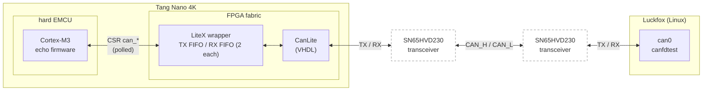

- **500 kbit/s** from the 54 MHz system clock: 9 time quanta per bit, sample point at 78 %.
- The bit-timing prescaler is computed from the clock in Python, so changing the clock can't
  silently break the bit rate.
- FIFOs are 2 frames deep: on this chip they are built from flip-flops, and space is tight.
- CAN is optional at build time (`--with-can`).

## 4.2 Seeing it work

The test uses `canfdtest` from Linux's can-utils (despite the name it works with classic CAN; "fd"
stands for full duplex). The Luckfox is the **generator**, the Tang Nano is the **device under
test**. The echo firmware is a short polling loop:

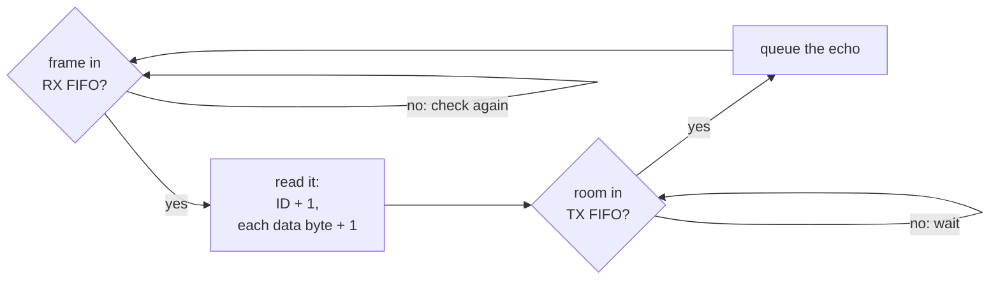

(once a second the loop also prints its counters over UART)

`canfdtest` then checks that every echo comes back, in order, with exactly those changes:

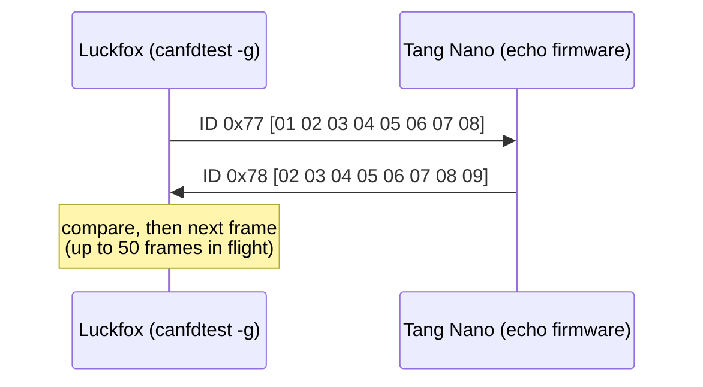

On the Luckfox:

```bash
ip link set can0 type can bitrate 500000 restart-ms 100
ip link set can0 up
canfdtest -g -l 20000 can0
```

`-g` makes the Luckfox the generator, `-l 20000` runs 20 000 round trips. The Tang reports its own
side over UART once a second:

```text
can t=..s rx=.. tx=.. bad=0 lost_rx=0 lost_tx=0 state=0
```

<!-- add: canfdtest output ("Test messages sent and received: 20000") and the Tang status line -->

Along the way the echo also passed 1-, 4- and 8-byte payloads, the lowest and highest 11-bit and
29-bit IDs, and strict one-frame-at-a-time ping-pong. Even with only 2-frame FIFOs and a polling
firmware, the Tang echoed every frame it received (`lost_rx = lost_tx = 0`), at canfdtest's full
rate of ~865 frames per second. The loop does nothing else, which is exactly what makes polling
fast enough here (3.6).

> [!note]
> The Luckfox's CAN clock (196.608 MHz) can't make exactly 500 kbit/s: Linux picks 499 005 bit/s
> with the sample point at 65 %. The Tang samples at 78 %. Both are well within what CAN tolerates
> on a short bench bus.

# 5. The Camera

## 5.1 Front-end: from sensor to a pixel stream

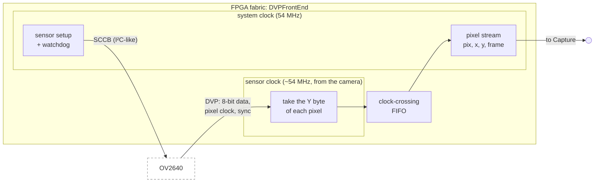

- The sensor setup comes from Sipeed's OV2640 example, set to **800 × 600 YUV**. We keep only the
  brightness byte (Y), which is the greyscale picture.
- The sensor sends pixels with its own clock, so they cross into the 54 MHz system clock through a
  small FIFO.
- Out comes a **stream**: one pixel at a time, with its x, y and frame number. It never pauses, and
  nothing downstream can make it wait.
- A **watchdog** re-sends the sensor setup if no frames arrive (this fixed cold power-ups).

Measured: **34 frames per second, 600 rows of 800 pixels each**.

## 5.2 Capture: a picture for a slow reader

First, what a picture looks like to the hardware: a grid of 800 columns by 600 rows, one byte per
pixel, sent row after row:

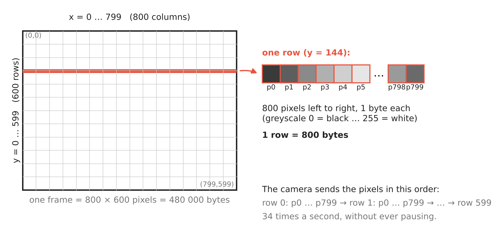

A picture is 480 KB, but the FPGA has only about 22 KB of memory, and the camera never stops. So
Capture never holds a whole picture. Instead it hands the M3 **one row at a time**. Each row is
wrapped into a small packet that says which row it is, and that packet sits in a **slot**:

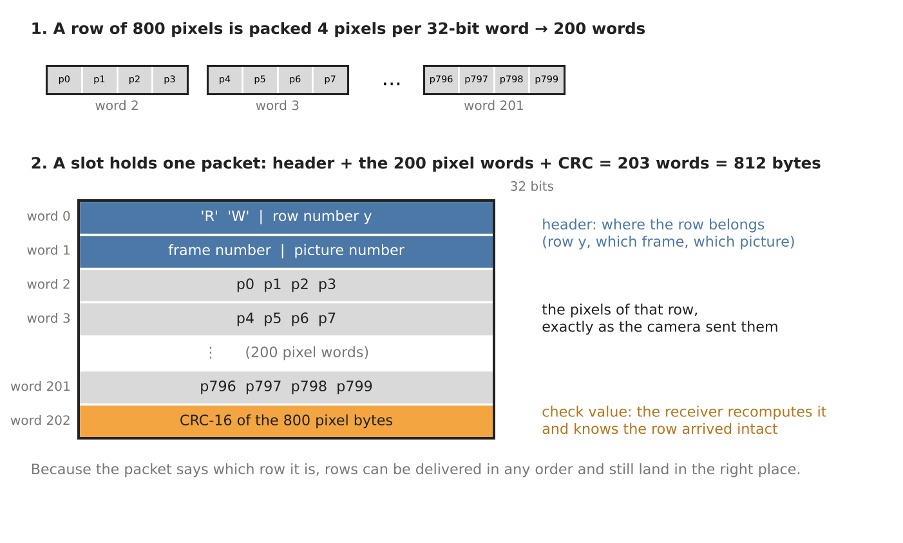

Capture has 5 slots and a **checklist** of the 600 rows (has this row already been delivered for
the current picture?). At the start of every camera row it makes one decision:

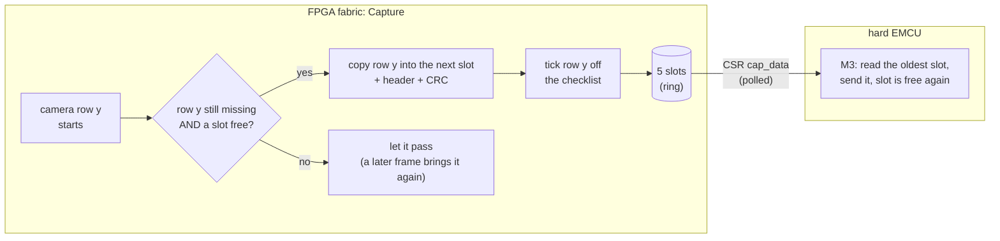

- **Why it always finishes:** every frame brings all 600 rows past Capture again. Whenever the M3 has
  freed a slot, the next missing row that comes by is taken. Rows already ticked off are never
  taken twice.
- **Why the M3 may be slow:** a late M3 only means fewer rows per frame, so the picture takes more
  frames. No row is ever half-written or lost.
- **Why rows can come in any order:** every packet carries its row number, and a **CRC** so the
  receiver can check it arrived intact.
- **Starting a new picture** doesn't clear anything: the checklist stores a picture number per row,
  and "missing" means "not this picture's number yet".

For the firmware it's four lines:

```c
capture_start();
while (capture_busy())
    if (capture_ready()) {
        capture_read(pkt);       // one row: number, frame, 800 pixels, CRC
        send(pkt);
    }
```

## 5.3 Getting the picture out

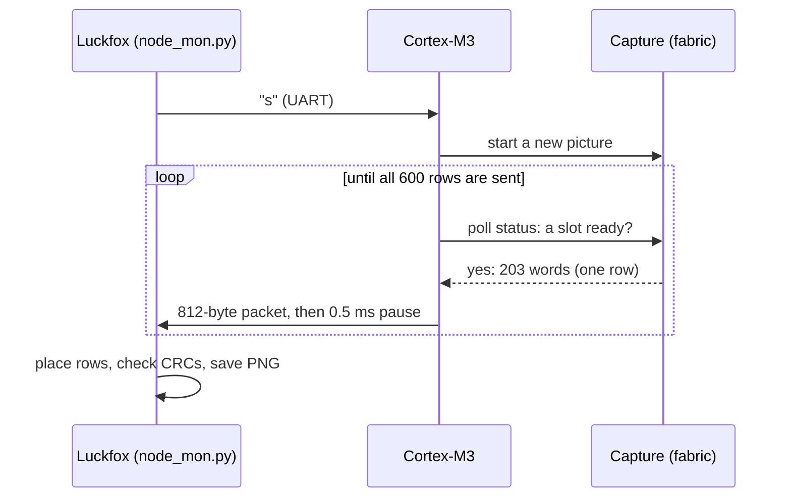

- The M3 sends the rows over **UART at 3 Mbaud** to a Luckfox board running Linux. The Luckfox's
  UART driver lost data on a continuous stream, so the M3 pauses a small delay after each row.
- A small Python script on the Luckfox puts the rows in place, checks every CRC and saves a PNG:

```sh
root@luckfox:~# python3 node_mon.py /dev/ttyS1 --quiet
00:54:45.397  listening on /dev/ttyS1 at 3000000 baud (status lines hidden) -- keys: s / t then Enter, Ctrl+C quits
00:54:47.588  == Tang Nano 4K camera node 800x600 | s = picture, t = drain test ==
s
00:54:56.078  PIC picture=1 rows=600 bytes=812
00:54:58.768  picture 1 -> out/pic1.png  rows 600/600  crc_bad 0  bad_hdr 0  dup 0
00:54:58.768      1.90 s  0.26 MB/s  frames 284..346
00:54:58.769  PIC_END picture=1 frames=284..346
s
00:55:02.002  PIC picture=2 rows=600 bytes=812
00:55:04.618  picture 2 -> out/pic2.png  rows 600/600  crc_bad 0  bad_hdr 0  dup 0
00:55:04.619      1.89 s  0.26 MB/s  frames 484..546
00:55:04.620  PIC_END picture=2 frames=484..546
t
00:55:06.533  drain: picture=3 rows=600 frames=635..637 (3 frames)
t
00:55:07.014  drain: picture=4 rows=600 frames=651..653 (3 frames)
^Croot@luckfox:~# ls out/
pic1.png  pic2.png
```

`t` is the drain test: the M3 reads a whole picture without sending it. It finishes in 3 frames,
against ~63 frames with the UART.

Pictures:
<div style="display: flex; gap: 12px;">
  <figure style="flex: 1; margin: 0;">
    
    <figcaption>Picture 1:The ceiling</figcaption>
  </figure>
  <figure style="flex: 1; margin: 0;">
    
    <figcaption>Picture 2: Same view, with a shaka 🤙</figcaption>
  </figure>
</div>

> [!note] Why the hand looks sliced
> Picture 2 was built from camera frames 484 to 546 (62 frames), about 1.9 s of real time. Each frame
> contributed only a handful of rows, spread over the whole height, while the hand was moving. So
> neighbouring rows show the hand at different moments, and it comes out in slices. The still
> ceiling looks perfect because it didn't change in those 1.9 s.

# 6. Results

| | Result |
|---|---|
| Camera | 800 × 600, 34 fps |
| Picture | 600 / 600 rows, 0 CRC errors |
| Time per picture | ~1.9 s over UART (0.26 MB/s) |
| Same picture without the UART | 3 frames (~90 ms) |
| CAN echo | 500 kbit/s, ~865 frames/s, no frame lost |

**The FPGA and the M3 are fast; the link sets the pace.**

Resource utilization:
```sh
== resources (impl/pnr/project.rpt.txt)
3. Resource Usage Summary
  Resources                   | Usage                               | Utilization
  Logic                       | 2522/4608                           |  55%
    --LUT,ALU,ROM16           | 2522(2289 LUT, 233 ALU, 0 ROM16)    | -
    --SSRAM(RAM16)            | 0                                   | -
  Register                    | 2123/3573                           |  60%
    --Logic Register as Latch | 0/3456                              |  0%
    --Logic Register as FF    | 2108/3456                           |  61%
    --I/O Register as Latch   | 0/117                               |  0%
    --I/O Register as FF      | 15/117                              |  13%
  CLS                         | 1974/2304                           |  86%
  I/O Port                    | 24/39                               |  62%
  I/O Buf                     | 22                                  | -
    --Input Buf               | 15                                  | -
    --Output Buf              | 7                                   | -
    --Inout Buf               | 0                                   | -
  BSRAM                       | 8/10                                | 80%
    --SDPB                    | 7
    --pROM                    | 1
  FLASH256K                   | 1/1                                 | 100%
  EMCU                        | 1/1                                 | 100%
  ================================================================================
```

# 7. Lessons Learned

- **Support is nice**: litex framework builds open a very awesome concept for building SoC systems, with the caveat of the dev board being supported. Primary engineering decisions should be regarding support.
- **Measure before guessing**: a quick "read without sending" test showed the link was the
  bottleneck, not the FPGA.
- **Buffer in hardware when you can't interrupt**: with no fabric interrupts, the camera works
  because Capture absorbs a slow M3; CAN works only as long as the loop never blocks.
- **Vendor tools have opinions**: Gowin needed the M3's flash line wired by hand, and only uses
  block RAM when asked explicitly.
- **Small things bite**: LiteX's `printf` ends lines with `\n\r`, which shifted the first picture
  byte until the receiver skipped it.

# 8. What's Next

The camera stream is now a base: new blocks can sit next to Capture and hand the M3 small results
instead of whole pictures. And connecting the fabric interrupt lines to the NVIC would let CAN and
the camera run in the same firmware.

